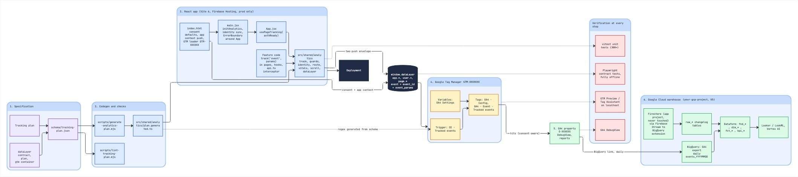

# Clickstream data collection framework

Schema-driven clickstream tracking for a React web app, from the tracking plan to the data warehouse.

It was built for a production edtech platform used mostly by high school students. The brand, IDs and app code are removed. What remains is the part that makes the data trustworthy: one tracking plan that the code enforces, a single `track()` entry point with privacy guards, and a fixed dataLayer contract for Google Tag Manager.

> Video walkthrough: _add link_



## The idea

Most clickstream data drifts. Event names change between developers, personal data slips into parameters, and by the time the data reaches the warehouse nobody trusts it. Here the tracking plan is the source of truth, and the code cannot send anything the plan does not allow.

1. **Specification.** The tracking plan (events, parameters, allowed values, routes, user properties) is compiled into `schema/tracking-plan.json`.
2. **Codegen and checks.** `scripts/lint-tracking-plan.mjs` checks the plan for naming, missing definitions and PII-risk fields. `scripts/generate-analytics-plan.mjs` turns it into `analytics/plan.generated.ts`, so the allowlist, parameter types and route map in the app always match the plan.
3. **The app.** Feature code calls `track('event_name', params)`. Every call goes through one checkpoint (`analytics/`) before anything reaches `window.dataLayer`.
4. **Google Tag Manager.** One GA4 event tag maps `event_params.*` from the dataLayer. The trigger's event list is generated from the schema.
5. **GA4 to BigQuery.** The daily export lands in BigQuery for modelling.

## The guard pipeline

Every `track()` call runs these steps in order. Anything that fails is dropped, never sent half-cleaned.

| Step | What it does |
|---|---|
| Allowlist | The event must exist in the plan, must not be deprecated, and must not be server-only (`purchase`, `refund`). |
| Page context | No event fires before a `page_view`, so every event carries `page_template` and `content_group`. |
| Tutor-mode substitution | When a tutor views a student's work, the student's activity events are replaced with one `student_work_view`, so tutors never inflate student metrics. |
| Parameter filter | Unknown parameters are dropped. PII keys (`email`, `name`, `message`, `text` and so on) are dropped. Any value that looks like an email is dropped. Types are coerced and checked. Strings are capped at 100 characters. |
| Envelope | A reset push (`event_params: null`, `ecommerce: null`) followed by the event with a unique `event_id`, so no parameter leaks from one event into the next. |

URLs are cleaned too: `page_location` keeps only `utm_*` and `gclid`, external referrers are cut to origin and path, and ID-like path segments in API endpoints become `:id`.

## Consent

`index.html` sets Consent Mode defaults before GTM loads: advertising storage denied for everyone, analytics denied in the EEA, UK and Switzerland and granted elsewhere, with no banner and no updates. In GTM, both GA4 tags require `analytics_storage`, so they do not fire at all where it is denied. Adjust the region list to your own legal advice.

## Repository layout

```
schema/tracking-plan.json        The tracking plan: events, parameters, routes, user properties
scripts/lint-tracking-plan.mjs   Checks the plan
scripts/generate-analytics-plan.mjs  Generates analytics/plan.generated.ts from the plan
analytics/                       The module: track, guards, route, identity, ecommerce, trackAiCall, vitals, scroll
analytics/__tests__/             Unit tests
index.html                       Load order: dataLayer, consent defaults, app context, GTM
```

## Using it

```ts
import { initAnalytics, identify, usePageTracking, track } from './analytics';

// Once, before render
initAnalytics({ onViolation: import.meta.env.DEV ? 'warn' : 'silent' });

// On every auth change: an opaque ID only, never an email or name
identify({ uid: user?.uid ?? null, role: user?.role, isSignedIn: !!user });

// In the root component, after auth has resolved
usePageTracking(authReady);

// Anywhere in feature code, after the action succeeds
track('test_complete', { test_id: test.id, test_type: 'practice', score: 1340 });
```

`trackOnce(key, name, params)` fires once per key per page view. `trackAiCall()` wraps AI requests and records outcome, latency and sizes, never prompt or response text.

## Running it

```
npm install
npm run lint:plan   # check the tracking plan
npm run generate    # regenerate analytics/plan.generated.ts
npm test            # generate, then run the unit tests
```

Set `VITE_GTM_ID` in your own `.env` (see `.env.example`). GTM and GA4 IDs in this repo are placeholders.

## Not included

The application itself, the GTM container export, the GA4 property, the warehouse models and the end-to-end browser tests are specific to the original product and are not part of this repo.

## License

MIT. See `LICENSE`.
